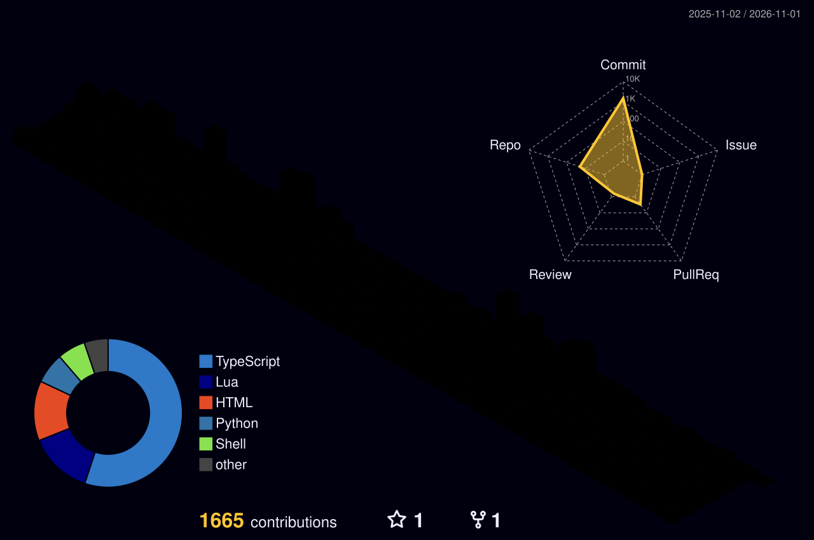

## 👋 Hey, I'm Lucas Ferreira!

### 👉 [🇧🇷](#portugues) 👈

  🎓 Computer Engineering Student @ **UNIVESP** · 👨‍💻 Application Developer @ **Atos Brasil**

🔐 Cybersecurity Enthusiast · 🤖 AI Explorer · 🔭 Astrophysics Lover · 🎮 Gamer

> *Building things that matter, breaking pointless rules, and striving to be better today than yesterday.*

📫 **Reach me:**

  
  
  

<b>📊 GitHub Contribution Stats</b>

 

  

---

## 👋 E aí, eu sou o Lucas Ferreira!

### 👉 [🇺🇸](#english) 👈

🎓 Estudante de Engenharia da Computação @ **UNIVESP** · 👨‍💻 Desenvolvedor de Aplicações @ **Atos Brasil**

🔐 Entusiasta de Cybersecurity · 🤖 Explorador de IA · 🔭 Amante de Astrofísica · 🎮 Gamer

> *Construindo o que faz a diferença, quebrando coisas sem sentido e tentando ser melhor hoje do que ontem.*

📫 **Fale comigo:**

---

<b>🔥 GitHub Streak</b>

   
  

---

 
  
<h2>🚀 Projects I'm Currently Working On</h2>

  

    
    
    
    
    
    
    
  

  

---

## 🛠️ Tech Stack

  
  
  
  
  
  
  
  
  

---

   
  

